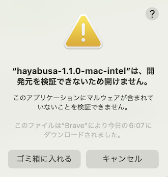
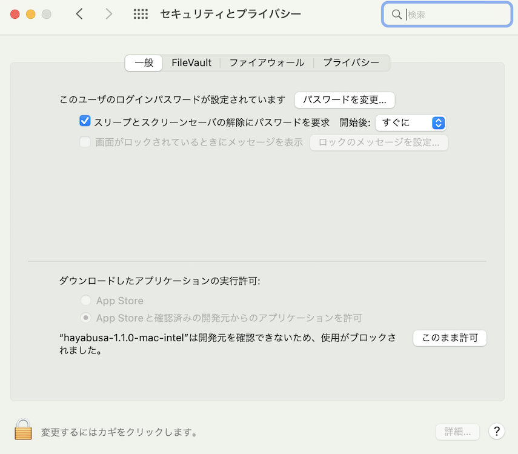
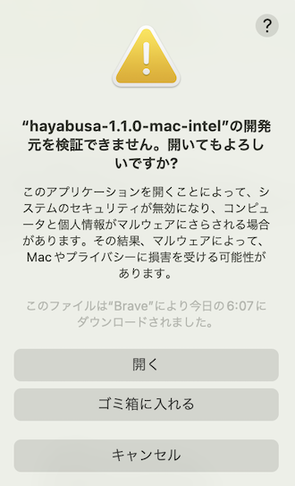

# Hayabusaの実行

## 注意: アンチウィルス/EDRの誤検知と遅い初回実行

Hayabusa実行する際や、`.yml`ルールのダウンロードや実行時にルール内でdetectionに不審なPowerShellコマンドや`mimikatz`のようなキーワードが書かれている際に、アンチウィルスやEDRにブロックされる可能性があります。
誤検知のため、セキュリティ対策の製品がHayabusaを許可するように設定する必要があります。
マルウェア感染が心配であれば、ソースコードを確認した上で、自分でバイナリをコンパイルして下さい。

Windows PC起動後の初回実行時に時間がかかる場合があります。
これはWindows Defenderのリアルタイムスキャンが行われていることが原因です。
リアルタイムスキャンを無効にするかHayabusaのディレクトリをアンチウィルススキャンから除外することでこの現象は解消しますが、設定を変える前にセキュリティリスクを十分ご考慮ください。

## Windows

コマンドプロンプトやWindows Terminalから32ビットもしくは64ビットのWindowsバイナリをHayabusaのルートディレクトリから実行します。

### パスにスペースが含まれるファイルまたはディレクトリをスキャンしようとするとエラーが発生した場合

Windowsに組み込まれているコマンドプロンプトまたはPowerShellプロンプトを使用する場合、ファイルまたはディレクトリのパスに空白があると、.evtxファイルをロードできないというエラーが表示されることがあります。
.evtxファイルを正しくロードするために、以下のことを行ってください:

1. ファイルまたはディレクトリのパスをダブルクォートで囲む。
2. ディレクトリパスの場合は、最後の文字にバックスラッシュを入れない。

### 文字が正常に表示されない場合

デフォルトのフォントがWindowsの`Lucida Console`の場合、ロゴやテーブルに使用されているさまざまな文字が正しく表示されません。
フォントを`Consolas`に変更することで、これを修正できます。

これにより、ほとんどのテキスト表示の問題は修正されますが、終了メッセージに含まれる日本語文字の表示は修正されません。


以下の4つのオプションのいずれかで修正できます：

1. [Windows Terminal](https://learn.microsoft.com/en-us/windows/terminal/)をCommand PromptまたはPowerShellの代わりに使用する。（推奨）
2. `MS Gothic`フォントを使用する。ただし、バックスラッシュが円記号（¥）に変わることに注意してください。
   
3. [HackGen](https://github.com/yuru7/HackGen/releases)フォントをインストールし、`HackGen Console NF`を使用する。
4. 日本語を含む終了メッセージを表示しないために、`-q, --quiet`オプションを使用する。

## Linux

まず、バイナリに実行権限を与える必要があります。

```bash
chmod +x ./hayabusa
```

次に、Hayabusaのルートディレクトリから実行します：

```bash
./hayabusa
```

## macOS

まず、ターミナルやiTerm2からバイナリに実行権限を与える必要があります。

```bash
chmod +x ./hayabusa
```

次に、Hayabusaのルートディレクトリから実行してみてください：

```bash
./hayabusa
```

macOSの最新版では、以下のセキュリティ警告が出る可能性があります：



macOSの環境設定から「セキュリティとプライバシー」を開き、「一般」タブから「このまま許可」ボタンをクリックしてください。



その後、ターミナルからもう一回実行してみてください：

```bash
./hayabusa
```

以下の警告が出るので、「開く」をクリックしてください。



これで実行できるようになります。

## VHDX イメージの入力（Linux）

すべてのイベントログ解析コマンドで、`--vhdx` と `-f <IMAGE.vhdx>` または `-d <IMAGE_DIRECTORY>` を指定できます。イメージは指定ディレクトリから最大3階層下まで探索します。イメージ内部では階層数を制限せず、読み取り可能な全NTFSボリュームのログを探索します。

```bash
./hayabusa dfir-timeline --vhdx -f host.vhdx -w -U -p verbose -o timeline.csv
./hayabusa dfir-timeline --vhdx -d images/ -w -U -p verbose -o timeline.csv
./hayabusa log-metrics --vhdx -d images/ -U -o logs.csv
```

Juntei と同じ `ys-vhdx-mount` を使って読み取り専用でマウントします。Linux、`/dev/fuse` へのアクセス、`fusermount3` が必要です。root 権限や Juntei のインストールは不要です。Debian/Ubuntu では `sudo apt install fuse3` で補助プログラムをインストールできます。全内容を作業用ディレクトリへ展開せず、直接読み取ります。解析終了時と Ctrl+C、SIGTERM、SIGHUP の受信時にアンマウントします。

対象コマンドは `dfir-timeline`、`search`、`eid-metrics`、`log-metrics`、`logon-summary`、`computer-metrics`、`extract-base64`、`pivot-keywords-list`、`config-critical-systems` です。JSON 入力対応コマンドでは `-J` も使えます。通常のイベントログ入力は変更せず、VHDX には `--vhdx` を明示的に指定します。

出力の証拠パスは `host.vhdx!/Windows/.../Security.evtx` です。複数ボリュームの場合は `Volume1`、`Volume2` なども含まれ、一時マウント先の代わりに元イメージと内部パスを識別できます。入力と同じファイルを出力先に指定すると、シンボリックリンクやハードリンク経由でも拒否します。

読み取れないイメージやパーティション、対象ログがない場合は終了コードが非ゼロになります。一部が失敗しても読み取れるイメージの結果を保存する場合があります。警告を確認し、不完全な結果として扱ってください。対応ファイルシステムは NTFS のみです。BitLocker 暗号化ボリュームと外部の親イメージを必要とする差分イメージには対応しません。Windows/macOS では別のツールで読み取り専用マウント後、ログディレクトリを `-d` で指定してください。
