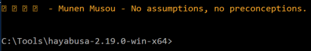
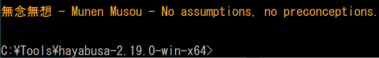
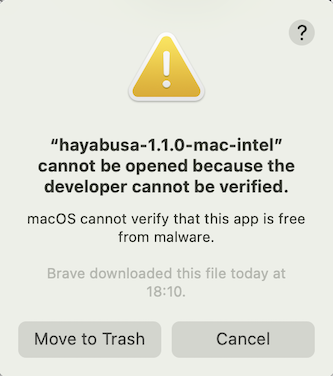
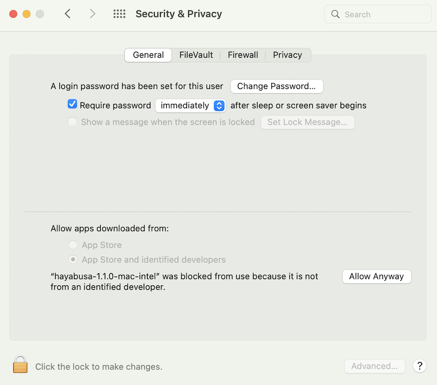
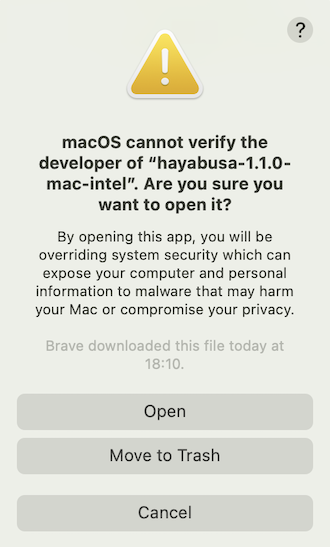

# Running Hayabusa

## Caution: Anti-Virus/EDR Warnings and Slow Runtimes

You may receive an alert from anti-virus or EDR products when trying to run hayabusa or even just when downloading the `.yml` rules as there will be keywords like `mimikatz` and suspicious PowerShell commands in the detection signature.
These are false positives so will need to configure exclusions in your security products to allow hayabusa to run.
If you are worried about malware or supply chain attacks, please check the hayabusa source code and compile the binaries yourself.

You may experience slow runtime especially on the first run after a reboot due to the real-time protection of Windows Defender.
You can avoid this by temporarily turning real-time protection off or adding an exclusion to the hayabusa runtime directory.
(Please take into consideration the security risks before doing these.)

## Windows

In a Command/PowerShell Prompt or Windows Terminal, just run the appropriate 32-bit or 64-bit Windows binary.

### Error when trying to scan a file or directory with a space in the path

When using the built-in Command or PowerShell prompt in Windows, you may receive an error that Hayabusa was not able to load any .evtx files if there is a space in your file or directory path.
In order to load the .evtx files properly, be sure to do the following:

1. Enclose the file or directory path with double quotes.
2. If it is a directory path, make sure that you do not include a backslash for the last character.

### Characters not being displayed correctly

With the default font `Lucida Console` on Windows, various characters used in the logo and tables will not be displayed properly.
You should change the font to `Consalas` to fix this.

This will fix most of the text rendering except for the display of Japanese characters in the closing messages:



You have four options to fix this:

1. Use [Windows Terminal](https://learn.microsoft.com/en-us/windows/terminal/) instead of the Command or PowerShell prompt. (Recommended)
2. Use the `MS Gothic` font. Note that backslashes will turn into Yen symbols.
   
3. Install the [HackGen](https://github.com/yuru7/HackGen/releases) fonts and use `HackGen Console NF`.
4. Use the `-q, --quiet` to not display the closing messages that contain Japanese.

## Linux

You first need to make the binary executable.

```bash
chmod +x ./hayabusa
```

Then run it from the Hayabusa root directory:

```bash
./hayabusa
```

## macOS

From Terminal or iTerm2, you first need to make the binary executable.

```bash
chmod +x ./hayabusa
```

Then, try to run it from the Hayabusa root directory:

```bash
./hayabusa
```

On the latest version of macOS, you may receive the following security error when you try to run it:



Click "Cancel" and then from System Preferences, open "Security & Privacy" and from the General tab, click "Allow Anyway".



After that, try to run it again.

```bash
./hayabusa
```

The following warning will pop up, so please click "Open".



You should now be able to run hayabusa.

## VHDX inputs (Linux)

All event-log scanning commands accept `--vhdx` with `-f <IMAGE.vhdx>` or `-d <IMAGE_DIRECTORY>`. Directory discovery checks the supplied root and up to three subdirectory levels; the log search inside each image has no three-level limit. All readable NTFS volumes are searched.

```bash
# One image
./hayabusa dfir-timeline --vhdx -f host.vhdx -w -U -p verbose -o timeline.csv

# A directory of images
./hayabusa dfir-timeline --vhdx -d images/ -w -U -p verbose -o timeline.csv

# Inspect the logs inside the images
./hayabusa log-metrics --vhdx -d images/ -U -o logs.csv
```

The images are mounted read-only through the same `ys-vhdx-mount` backend as Juntei. Linux, access to `/dev/fuse`, and `fusermount3` are required; root privileges and a Juntei installation are not required. On Debian/Ubuntu, install the runtime helper with `sudo apt install fuse3`. Image contents are read directly rather than extracted to a working copy. Hayabusa unmounts its images after the scan and on Ctrl+C, SIGTERM, or SIGHUP.

This input mode works with `dfir-timeline`, `search`, `eid-metrics`, `log-metrics`, `logon-summary`, `computer-metrics`, `extract-base64`, `pivot-keywords-list`, and `config-critical-systems`. Other options still apply, including `-J` for JSON event files on commands supporting JSON input. Use `--vhdx` explicitly: ordinary `-d` scans continue to look for event logs.

Evidence filenames use `host.vhdx!/Windows/.../Security.evtx`; multi-volume images include `Volume1`, `Volume2`, and so on. This identifies the image and internal path without persisting a temporary mount path. Inputs cannot be reused as output files, including through symbolic or hard links.

Unreadable images, unreadable partitions, or images without matching logs cause a nonzero exit status. If some images fail, readable images can still produce scan results; treat those results as incomplete and check the warnings. The backend reads NTFS volumes only. BitLocker-encrypted volumes and images requiring an external differencing parent are not supported by this mounting mode. On Windows or macOS, mount the image read-only using a platform tool and scan the mounted event-log directory with `-d`.
